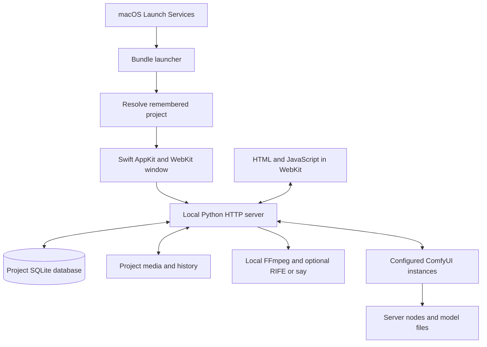

# Anime Studio architecture guide

Anime Studio is a local Python application presented in a native Swift/WebKit macOS window. It coordinates remote ComfyUI generation, stores project state in SQLite and uses local media tools for previews, audio mixing and episode assembly.

The architecture is intentionally small: no frontend build system, external JavaScript framework or hosted service is required for the core app. ComfyUI, model weights and optional custom nodes remain a separately maintained server environment.

## 1. Runtime boundaries

The native app defaults to `127.0.0.1:8700`. The Python server can be started directly with explicit host, port and data arguments. The bundled launcher resolves its own data location first; the standalone command's default is different, so development should always specify an isolated `--data` folder.

## 2. Module responsibilities

### Native shell and packaging

- [mac/launcher.sh](../mac/launcher.sh) finds Python/media tools, resolves project storage, checks for an existing local Anime Studio backend and starts the native window or fallback browser path. It records launch diagnostics in Application Support.
- [mac/main.swift](../mac/main.swift) creates the AppKit window and WebKit view, starts and owns the Python backend, handles native file dialogs/storage access and terminates its owned server on app exit.
- [mac/Info.plist](../mac/Info.plist) defines bundle identity, version and platform settings.
- [build_app.sh](../build_app.sh) creates the bundle, copies application resources and compiles the native executable when the toolchain is available. New modules must be included explicitly.

### Backend

- [app/anime_studio.py](../app/anime_studio.py): core schema/migrations, settings, assets/shots/takes/jobs, ComfyUI workflow patching, worker dispatch, output collection, audio rebuild and assembly, plus HTTP routing.
- [app/production.py](../app/production.py): input signatures, outdated-selection tracking, readiness, guided scene plans and script revision.
- [app/render_queue.py](../app/render_queue.py): queue grouping, timing-history retention and duration/progress estimates.
- [app/comfy_events.py](../app/comfy_events.py): optional remote execution events. Events supplement output-history collection; they do not independently prove output persistence.
- [app/shot_voices.py](../app/shot_voices.py): dialogue edit tokens, validated line/character identity and combined save/generation requests.
- [app/script_dialogue.py](../app/script_dialogue.py): script parsing, speaker/direction recognition and recoverable dialogue extraction from older picture prompts.
- [app/studio_tools.py](../app/studio_tools.py): checkpoints, scene cleanup, trimming/splitting/reorder, episode library, archive import/export, continuity, quality checks, subtitles and stems.
- [app/soundtrack.py](../app/soundtrack.py): timed cues, anchor resolution, rendered-episode registry and soundtrack-only exports.
- [app/project_storage.py](../app/project_storage.py): app-owned storage resolution and validated legacy-project copying.

- [app/creative.py](../app/creative.py): immutable reference versions, shot direction, recipe snapshots, server compatibility, repair composition, performance timing and phrase retakes. Creative jobs use the existing worker with a frozen `creative_json` payload; custom recipe compatibility is checked separately from the global workflow.

### Frontend

- [app/ui.html](../app/ui.html): shared design tokens/styles, navigation, page markup, state loading, modal lifecycle, scroll preservation and core workspace handlers.
- [app/shot_voices.js](../app/shot_voices.js): local dialogue draft, line navigation, voice validation, take review and result refresh.
- [app/editor.js](../app/editor.js): episode playback/editing, scene maintenance, history/library and delivery controls.
- [app/production.js](../app/production.js): production UI, revision/recovery previews and guided-plan controls.

- [app/creative.js](../app/creative.js) and [app/creative.css](../app/creative.css): Reference library, Generation lab and the Direction/Repair/Performance editors.

The browser loads a state snapshot and sends explicit mutations. Background polling is normally every four seconds and is limited while editing modal content; the dialogue modal allows result refresh while preserving its inputs. HTML is loaded into a module-level string at server start. Editing `ui.html` requires a backend restart for the served document to change; JavaScript resources are read on request.

## 3. Persistence model

A project folder contains `studio.db` and media directories such as `uploads`, `shots`, `cast`, `voices`, `exports` and `history`. Portable archives are written under `backups`. Logs and other working files may also appear there.

Core SQLite entities include:

- `settings`, `instances`, `workflows` for configuration.
- `assets`, `voice_clips` for shared cast and voice references.
- `shots`, `takes`, `voice_takes` for the current editorial media graph.
- `jobs`, timing history and production plans/approvals for execution state.
- `audio_cues`, `episode_audio_exports` for soundtrack editing and render masters.
- `edit_history`, `episode_library`, `continuity` for recovery, series storage and scene rules.

Schemas and migrations are distributed across the owning modules. Inspect their constructors as well as the core `SCHEMA` and `MIGRATIONS` lists before adding fields. Keep new values backward compatible with existing projects.

Database access uses a shared connection protected by a reentrant lock. Production mutations are also coordinated through the production lock. Multi-row editorial operations use transactions where required. SQLite state and media-file writes are not one universal cross-filesystem transaction; design failure recovery explicitly.

Store media paths relative to the project. Resolve and validate paths at file-access boundaries. UI display numbers and database IDs serve different purposes. Stable character/line IDs must survive renaming and repeated dialogue.

## 4. Native storage lifecycle

The launcher reads `~/Library/Application Support/AnimeStudio/data-folder`. App-owned projects normally live under that directory's `Project Data` or `Projects/<derived identifier>` paths. An explicit `ANIME_STUDIO_DATA` override is intentional and does not rewrite the remembered preference.

For legacy storage outside Application Support, migration copies media and uses SQLite's backup API to include committed database/WAL contents. It validates the copy, checks whether the source changed, writes a migration marker and updates the remembered location only after success. A conflict preserves both copies instead of silently replacing one.

Do not copy a live database as an ordinary isolated `studio.db` file or treat a permission error as evidence of corruption. Use the archive/backup APIs or a properly stopped project. Details and recovery steps are in [Operations](OPERATIONS.md).

## 5. Render lifecycle

1. Validate the stage, object prerequisites and eligible server readiness.
2. Persist a job, including seed, stage, relevant identity and captured inputs.
3. Dispatch waiting work by priority and server role/compatibility. A server handles one locally managed active job at a time.
4. Patch the workflow with prompts, input files, dimensions, frame count and seed values.
5. Submit to ComfyUI and persist its remote prompt ID and server association.
6. Poll remote history and optionally consume execution events.
7. Download outputs and record the take.
8. Apply permitted automatic selections and rebuild derived audio when appropriate.
9. Mark successful work complete after collection, not when a duration estimate reaches its limit.

Typical persisted job statuses are `pending`, `running`, `done`, `error` and `cancelled`. Remote prompt IDs enable reconnecting after a local restart/download problem. Recovery must not blindly submit the same remote request twice. Explicit cancellation and an execution failure have different retry behavior from a failed download.

ComfyUI `/object_info` checks node classes and advertised model names. Readiness is cached for 60 seconds and can be explicitly refreshed. It cannot prove model-managed internal weights, available GPU memory or output quality. Server roles describe permission/routing, not installation.

## 6. Dependency tracking and guided plans

A generated take's input signature records the applicable prompts, references, timings, upstream selections and workflow information. Comparing it to the current inputs produces current/outdated/unknown provenance. Keep immutable candidate media available even when a selection becomes outdated.

Guided plans progress through voices, keyframes, keyframe approval, animation/continuations and optional finishing. Approval binds to the keyframe and its current inputs. The keyframe selection API also records approval and wakes plans waiting on that scene; it is not necessary to assume a second UI click always occurs. A changed keyframe input requires review again. Plans persist their phase and jobs; failed jobs or unavailable stages block progress with an explanation.

Avoid adding a new render stage only to the UI. Update stage constants, workflow mapping, prerequisites, signatures, server routing, output collection, plan progression, queue labels and tests together as applicable.

## 7. Dialogue consistency contract

`/api/shot/voices` accepts a shot, current edit token, complete line list, requested generation indexes, take count and explicit whole-file replacement decision. Each saved line is validated before mutation. The current limits are 200 lines per request and 20,000 characters per spoken line; delivery is bounded separately.

The edit token detects changed dialogue, character choices and audio mode. A stale client must review the latest shot rather than overwriting it. A combined request saves validated words/characters first, then generates from those saved lines. `dialogue_saved` can therefore be true even when generation fails readiness or rebuilding derived audio fails.

Each generated voice job captures character ID, stable line ID, reference audio/transcript and delivery. New results must match their intended line inputs before being applied. A performance selected by the user while other takes render must not be replaced blindly by a later automatic result.

The frontend owns its unsaved draft. Polling may update takes/pending/audio fields for matching saved lines, but must not replace the full draft or input DOM. Selecting a take uses the saved line's identity/index and preserves edits in other lines.

## 8. Audio, assembly and delivery

Line audio is rebuilt into a shot dialogue track with gaps and silence for missing lines. Whole-shot audio overrides bypass line mixing until explicitly replaced. Duration fitting is operation-dependent: generation/selection can extend a shot; saving its draft alone does not guarantee fitting.

Assembly uses selected media, source-in and shot duration, converts to configured output dimensions/fps and creates per-shot clips, an episode and EDL. Continued animation is a chain; source timing and overlap handling matter when modifying this code.

Timed cues resolve either an absolute episode start or shot start plus anchor offset. Missing anchors are disabled. Soundtrack-only export uses an existing episode's picture and, when available, its clean dialogue master. It does not submit remote render work.

Quality checks inspect the current edit. Subtitle generation uses its dialogue/timing. Stems use the chosen rendered master and current cue settings. Do not imply that checking the current edit validates an older rendered export automatically.

## 9. Recovery boundaries

Checkpoints contain editorial snapshots and preserved versions of mutable dialogue mixes. Restore validates data, saves the current state first and leaves server configuration/job history outside ordinary editorial replacement. Restored active plans require review before resuming.

Episode switching shares assets and voice clips while applying episode-specific snapshots. Portable archives include database, media, exports and recovery files; imports namespace media and validate archive entries/database integrity. They do not replace the machine's server configuration with the imported configuration.

Deletion often removes active records while retaining source media for checkpoints and exports. There is no general automatic disk-reclamation policy. Add purge behavior only with explicit retention semantics and recovery tests.

## 10. API and trust boundaries

The local interface is an implementation API, not a promised stable public integration SDK. The route map in `anime_studio.py` is the reference for supported endpoints.

Useful read routes are `/api/ping`, `/api/state`, `/api/csv/export`, `/api/workflow/<stage>` and project-scoped `/media/<path>`. Mutations use JSON POST routes; `/api/editor` dispatches editorial tools. File uploads use the app's name/data payload format rather than a generic multipart contract.

Business failures can return HTTP 200 with `{ "ok": false, "error": "..." }`. Clients must inspect the body. Some operations can partially succeed and include a distinct result flag, such as saved dialogue with no queued voices.

The bundled backend binds to loopback and has no general user-authentication layer. Every request must carry a loopback `Host` header (`127.0.0.1`, `localhost` or `[::1]` plus the port), and every POST must be `application/json` with no `Origin` or a same-origin one. This blocks other websites in the user's browser (cross-site form or `text/plain` posts) and DNS rebinding. To reach the backend from another machine on purpose, start it with `--host <address>` or list host names in `ANIME_STUDIO_ALLOWED_HOSTS`; local clients and tests must send `Content-Type: application/json`. Treat it as a local application service, not an internet-facing server. ComfyUI addresses should be reachable through the deployment's intended trusted network. Validate paths, uploads, archive contents and user-controlled text at their owning boundaries; local operation does not make those inputs inherently safe.

## 11. Change and validation workflow

Use isolated data directories and mock ComfyUI for automated tests. Test business behavior rather than only matching rendered strings. Retain coverage for stable IDs, wrong-character rejection, duplicate submission, stale previews, history recovery, trim/source timing and render reconnects.

Run the appropriate unit/UI suites, then the mock pipeline for rendering/audio/queue changes. Inspect packaged resources after a native build. New files do not enter the bundle automatically. Keep source version and both bundle version fields synchronized; only bump when requested by the release workflow.

See [Operations](OPERATIONS.md#9-development-validation) for commands and [Design acceptance](DESIGN-GUIDE.md#10-review-a-new-feature) for UI checks.

## 12. Creative tool contracts

`POST /api/creative` dispatches named actions for reference versions/bindings, continuity review, direction, recipe authoring/assignment/checks/experiments, repairs and performances. Read-only previews use this same local tool endpoint. See [Creative tools](CREATIVE-TOOLS.md) for user-visible behavior and input conventions.

Recipe jobs snapshot workflows, scalar values and composed media inputs before dispatch. The dispatcher considers the recipe’s own compatibility, even if the global workflow is unavailable. Remote prompt reconnection keeps that snapshot. Comparison runs require explicit result selection; phrase outputs are stored separately until spliced into a full-line take. History/episode/archive handling includes the creative tables, with shared reference/recipe/pronunciation data separated from episode-specific shot controls.

## Continuation section data and Settings workspace

`continuations.py` owns `shot_sections` (per-shot/segment direction and camera) and `section_takes` (retained generation provenance). These participate in history and episode snapshots. `/api/section` exposes inspect/save/extend; normal `/api/generate` continuation requests freeze through the existing creative queue metadata. Worker dispatch uses the captured API graph, parameters and copied boundary PNG. Signatures include the saved section direction and selected predecessor chain/file stamps; changed sources preserve candidates while marking them outdated. Explicit scene-plan fallback is saved per section. Old projects do not invent historical section direction.

`settings.js`/`settings.css` provide focused Settings navigation, durable in-memory drafts, per-server dialogs and a single selected workflow editor. `/api/settings`, instance and workflow routes retain their ownership. UI numeric validation precedes submission; save results are checked before success messages or draft clearing. Project drafts are independent of server/workflow edits.

## 2.11 reliability and editing

`JobSnapshots` stores immutable job graphs, composed parameters, controls, input copies and signatures in `jobs.snapshot_json`. Queue mutation is locked through capture, with pending batch rollback on capture failure. Dispatch validates the captured graph independently of later global workflow readiness. Worker compose/build/collection use the captured key and fps. Repeat creates another job/run identity and preserves inputs/seed. Source copies stay under uploads/job-inputs and participate in archive/reference protection while retained by queue records.

`alignment.py` owns asynchronous local CPU recognition jobs and process groups, with setup in an isolated Application Support environment. `alignment_worker.py` normalizes audio with FFmpeg, obtains faster-whisper word timestamps and sends structured output back. Script matching uses normalized Unicode characters with per-word confidence and rejects missing, overlapping or low-confidence ranges. Results are suggestions protected by a performance token; no automatic selection/save occurs. The main app backend keeps its standard-library-only dependency model.

`workspace.py` provides cached waveform peaks and cut-boundary source frames. `workspace.js` renders tracks and pointer gestures, scopes local recovery drafts by project identity/episode and shows version/build metadata. Native WKWebView uses its persistent default data store. `storage_manager.py` inventories files and references from current/archived/history/job rows; reviewed candidates move to per-batch recoverable trash. Purge rechecks inventory, references, review token and explicit confirmation. Protected categories and symlinks are excluded. `render_diagnostics.py` classifies actionable errors without changing captured retry inputs.
