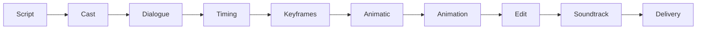

# Anime Studio documentation

Anime Studio is a macOS production app for turning scripts, character references and shot decisions into an assembled anime episode. ComfyUI produces images, video and character voices; the Mac manages the project, editorial decisions, audio timing, assembly and delivery.

These guides describe the 2.11 codebase and its current dialogue UX. They are product documentation, not a promise that every ComfyUI model, GPU or custom workflow has been qualified on every machine.

## Choose a guide

- **[Creative tools](CREATIVE-TOOLS.md):** reference versions, pose/camera direction, selective repairs, performance editing and recipe experiments.
- **[Manga Studio](MANGA-STUDIO.md):** speech-bubble tagging, how keyframe prompts are built, and the roadmap for pages, lettering and export.
- **[Product guide](PRODUCT-GUIDE.md):** terminology, first project, every workspace, dialogue and character voices, generation, episode editing, music, recovery and final delivery. Start here to use the app.
- **[Design guide](DESIGN-GUIDE.md):** product principles, navigation, visual tokens, component anatomy, interaction states, accessibility, writing and acceptance criteria. Use this when designing or implementing a feature.
- **[Architecture guide](ARCHITECTURE.md):** runtime, modules, persistence, render dispatch, voice identity, dependency tracking and API conventions. Start here to change the implementation.
- **[Operations guide](OPERATIONS.md):** Mac setup, manually maintained ComfyUI servers, TTS and lip sync, API workflows, native rebuilds, backups, diagnostics and testing.
- **[UX quick reference](UX.md):** short rules for day-to-day implementation and review.

## A first production pass

1. Configure servers and run readiness checks.
2. Import a short script and inspect the resulting shots.
3. Establish character images and reference voices.
4. Generate dialogue, choose performances and settle shot lengths.
5. Generate and approve keyframes; preview an animatic.
6. Animate, continue longer shots and add optional lip sync/upscaling.
7. Edit the episode and add music and sound effects.
8. Run quality checks, build the episode and review delivery files.

This is a working order, not a lock on navigation. Users can revisit earlier decisions; changed inputs can make downstream selections outdated.

## Documentation ownership

Treat source behavior and visible UI labels as the reference when updating these guides. Change user instructions with the feature that changes them. Keep implementation contracts in Architecture, server commands in Operations and interaction requirements in Design. Release-history sections in the root README provide historical context; these guides describe the current workflow.

Examples use fictional characters and generic server addresses. Project data, recordings, generated episodes and machine-specific configuration do not belong in documentation commits.
